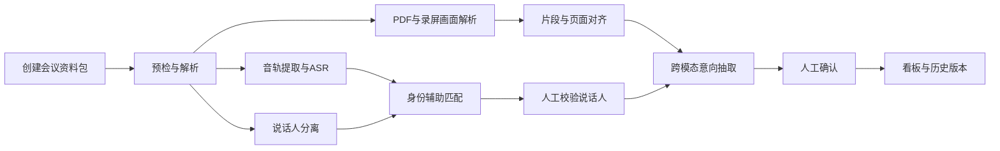

# 《意向宝》智能体软件开发方案

> 版本：V1.0（方案确认版）  
> 编制日期：2026-07-30  
> 当前状态：已完成需求与技术方案确认，尚未开始产品代码开发  
> 首期试点：MNT SBU／显示器产品企划团队  
> 适用对象：业务定义者、技术实现者、验证评估者、产品整合者及后续运维人员

---

## 0. 文档说明

### 0.1 编制目的

本文档将《意向宝》从产品定义进一步落实为可实施的软件开发方案，统一产品范围、处理流程、模型分工、技术栈、数据结构、页面功能、部署方式、验收标准、风险边界与后续待办。

本文档是后续原型设计、任务拆分、技术验证和软件开发的共同依据。未经变更评审，不应在开发过程中把意向宝扩展为CRM、销售自动化、客户总分工具或未经人工确认的自动决策系统。

### 0.2 状态标识

| 标识 | 含义 |
| --- | --- |
| 已确认 | 已由项目发起人确认，开发时按此实施 |
| 目标 | 需要通过后续开发和真实样本验证，不代表当前已经实现 |
| 待实测 | 方向已经确定，但具体模型、参数或性能需通过基准测试选择 |
| 待办 | 当前缺少外部条件或业务信息，先记录，不阻塞总体方案 |
| 不在首期 | 明确不进入首期开发范围 |

### 0.3 事实边界

- 当前已完成产品定义、行业调研、招募材料、招募网页、招募短视频和课题报告。
- 当前尚未形成可运行的意向宝产品MVP。
- 首期可以使用模拟数据验证产品流程和界面。
- 真实模型准确率必须基于获得授权、完成脱敏并经过人工标注的会议材料验证。
- “关键意向结构化准确率不低于85%”是后续目标，不是已经取得的成绩。

---

## 1. 项目背景与建设目标

### 1.1 业务背景

显示器产品企划团队每周约开展5～10场客户会议，每月约20～40场。单场会议纪要整理和意向判断通常需要30～60分钟；跨客户、跨技术和跨平台汇总每周约发生3～5次，参与人数超过20人，汇总人通常还需投入2～3小时。

现有会议纪要、录音、录屏和演示资料分散保存，客户不同职能的支持、顾虑、阻力与变化难以持续比较。团队需要的不只是通用会议摘要，而是能进入产品规划的结构化证据。

### 1.2 一句话定义

意向宝是面向产品与技术规划人员的客户意向智能体：它把会议录音、录屏、转写稿、人工纪要及PDF资料，整理成“技术 × 客户 × 通用产品平台 × 客户内部平台/项目 × 客户职能”的证据化意向地图。

### 1.3 两项核心价值

1. 复盘过去：查漏补缺，识别应该导入但尚未导入的技术，定位卡在哪个客户职能，并为内部突破提供证据。
2. 面向未来：汇总各项技术进展、各客户意向和各产品平台机会，支撑未来产品路线与产品规划。

### 1.4 建设目标

- 将一场会议的多种材料组织为可重复处理的“会议资料包”。
- 自动完成语音转写、说话人分离、资料解析、画面匹配和意向建议。
- 平行呈现采购、开发、PM、产品、品质等客户职能的不同立场。
- 识别支持者、阻力方、卡点组织、卡点内容及决策影响。
- 由产品规划负责人确认正式结论，避免AI直接替代业务判断。
- 保留每次会议、每段证据和每次确认形成的历史版本。
- 支持以技术或客户为主视角进行跨平台、跨职能和跨时间查询。

---

## 2. 用户、角色与责任边界

### 2.1 目标用户

| 用户 | 核心任务 | 首期权限方向 |
| --- | --- | --- |
| 产品规划负责人 | 确认正式职能意向、客户技术采用阶段和规划结论 | 确认、修改、退回、查看全部结果 |
| 产品／技术规划人员 | 导入材料、整理主数据、分析技术与平台机会 | 导入、标注、分析、查看 |
| 材料整理人员 | 补充参会人、职能、别名及缺失资料 | 导入、预检、标注 |
| 管理与协同人员 | 查看已确认的技术、客户和历史变化 | 只读查看 |
| 系统管理员 | 配置模型、保存期限、字典和运行参数 | 系统配置与审计 |

### 2.2 首期与正式产品的差异

- 首期采用本地单用户模式，不要求登录。
- 首期所有操作统一记录为本地操作者，但数据表预留操作者、角色和权限字段。
- 正式产品预留系统管理员、材料整理者、产品规划确认人、只读查看者四类权限。
- 销售团队可以补充材料或提供多角度信息，但不设置强制的销售验证环节。
- 正式职能状态和客户技术采用阶段的最终确认人是产品规划负责人。

### 2.3 项目共创职责

| 共创职能 | 主要职责 |
| --- | --- |
| 业务定义者 | 定义客户意向维度、判定标准、主数据和真实业务场景 |
| 技术实现者 | 完成系统架构、模型编排、数据结构、前后端和部署 |
| 验证评估者 | 建立脱敏样本、人工金标准、指标体系和错例分析 |
| 产品整合者 | 负责交互、看板、演示、文档和最终作品整合 |

---

## 3. 产品范围

### 3.1 首期P0范围

1. 创建、编辑和查看会议资料包。
2. 上传录音、录屏、转写稿、人工会议纪要、PDF及参会信息。
3. 文件格式、大小、完整性和数据属性预检。
4. 音轨提取、语音转写及时间戳生成。
5. 多人会议说话人分离及Speaker A/B/C片段生成。
6. 根据参会名单、纪要和发言内容推荐姓名、角色和职能。
7. 人工校验说话人姓名、角色、组织和职能。
8. PDF解析、OCR、录屏关键帧提取及页面关联。
9. 客户、技术、通用平台、客户项目、职能和别名匹配。
10. 原始意向观察、五档态度、客户技术采用阶段、支持理由、反对理由和卡点建议。
11. 逐条确认和受约束的批量确认。
12. 技术视角看板、客户视角看板、证据下钻和历史变化。
13. 技术、客户、产品平台、客户项目、职能和别名字典。
14. 使用标准Excel模板批量导入基础字典。
15. 模拟数据明显标识、真实身份隔离和文件保存期限配置。

### 3.2 首期P1候选

- 规划洞察报告导出。
- 客户组织关系和决策影响图谱。
- 周期性变化提醒和汇总。
- 更多音视频格式。
- 移动端只读浏览优化。
- 企业单点登录、精细权限和完整审计后台。
- 与企业会议、文档或协同平台对接。

### 3.3 明确不进入首期

- 实时加入线上会议或提供会中助手。
- 跨会议声纹识别和客户人员声纹库。
- CRM、邮件、即时通讯和外部销售数据接入。
- 自动发送客户消息、邮件或外呼。
- 自动给整家客户计算单一意向总分。
- 销售机会排序、成交概率和营收预测。
- 未经人工确认自动发布正式规划结论。
- 多任务并行推理和大规模生产部署。
- 企业级复杂权限、单点登录和生产灾备。

---

## 4. 输入资料与会议资料包

### 4.1 会议资料包定义

一个会议资料包代表一次可独立追溯的客户交流事件，至少包含会议日期、客户、资料属性和一份可分析材料；可以包含多个技术、多个通用产品平台和多个客户内部项目。

会议资料包可以关联：

- 原始录音；
- 原始录屏；
- 已转写录音稿；
- 人工会议纪要；
- 会议发表PDF；
- 参会人名单；
- 补充说明和人工标签。

### 4.2 首期支持格式

| 材料类型 | 首期格式 | 处理方式 |
| --- | --- | --- |
| 录音 | MP3、WAV、M4A | 分段、ASR、时间戳、说话人分离 |
| 录屏 | MP4 | 提取音轨、关键帧和必要的加密抽帧 |
| 转写稿 | TXT、MD、DOCX、SRT、VTT | 文本解析、说话人线索解析 |
| 人工纪要 | DOCX、TXT、MD、PDF | 结构解析、参会人和结论抽取 |
| 会议资料 | 文本型或扫描型PDF | 文本提取、OCR、页面切片和语义索引 |
| 基础字典 | XLSX | 模板校验、预览、批量导入 |

### 4.3 容量基线

- 常规会议时长：60～90分钟。
- 首期建议最大会议时长：120分钟。
- 单个录音或录屏：不超过2GB。
- 单份PDF：不超过100页。
- 超限文件不静默截断，系统提示用户拆分后重新上传。

### 4.4 PDF配套规则

- 纯录音或转写稿原则上需要同时上传会议PDF。
- 录屏包含完整演示画面时，PDF可以不上传。
- 业务上确实不存在PDF时，产品规划负责人可以确认“无配套PDF”后继续分析。
- 无PDF的任务必须显示“资料不完整”，涉及产品、规格和平台的关联结果不得隐藏低置信度。

### 4.5 数据属性

每个资料包必须选择：

- 模拟数据；
- 授权脱敏数据；
- 企业真实敏感数据。

不同属性决定可调用的模型服务、可导出的内容和保存策略。系统不得仅依靠文件名推断数据属性。

---

## 5. 核心业务规则

### 5.1 双层意向模型

第一层是原始意向观察，记录某次会议中某个人员或可识别角色对某技术和平台范围表达的态度及其证据。

第二层是正式职能意向状态，由产品规划负责人综合一条或多条原始观察，确认到“客户＋技术＋平台范围＋客户职能”层。

人员的一句话不能自动覆盖整个职能的正式状态；互相矛盾的表达必须同时保留。

### 5.2 五档态度

| 档位 | 名称 | 判定含义 |
| --- | --- | --- |
| 5 | 主动推动 | 高度认可，并主动协调资源、推动测试、验证或导入 |
| 4 | 明确支持 | 明确认可价值，愿意评估、测试、推荐或配合 |
| 3 | 有条件／观望 | 有兴趣，但需要性能、成本、时间、资源或内部条件进一步验证 |
| 2 | 暂不支持 | 当前倾向不采用或不推进，存在较强顾虑但未彻底否定 |
| 1 | 明确反对／阻断 | 明确拒绝，或拥有把关／否决作用并阻止继续推进 |
| — | 未知 | 尚未发言、尚未触达或态度证据不足；不属于五档 |

关键约束：

- 五档表示对技术或产品方向的态度，不是成交概率。
- 没有证据不得形成1～5档。
- “没有提到”只能判定为未知，不能判定为不支持。
- 职能无法确认属于待整理材料，不等同于“态度未知”。
- 同一职能意见冲突时，保留原始观察，由产品规划负责人确认正式状态。

### 5.3 客户技术采用阶段

客户技术采用阶段独立于职能态度，状态键为“客户＋技术＋平台范围”。

| 阶段 | 含义 |
| --- | --- |
| 未明确／未进入 | 尚未形成可判断的导入活动 |
| 初步了解 | 已介绍或讨论技术，尚未进入正式评估 |
| 内部评估 | 客户内部正在评估价值、条件或可行性 |
| 样品／技术验证 | 已提出或开展样品、规格、性能或可靠性验证 |
| 产品项目规划 | 技术进入具体产品或项目规划讨论 |
| 确认导入 | 已有明确的导入决定或正式计划证据 |
| 暂停／放弃 | 当前停止推进，必须记录原因和时间 |

### 5.4 支持者、阻力和卡点

- 支持者：除态度4或5外，还需要主动推荐、协调资源或推动验证的证据。
- 阻力方：态度1或2，或掌握关键把关条件且明确不支持。
- 卡点职能：成本、规格、可靠性等未解决条件所属的客户组织。
- 卡点内容：成本、性能、规格、品质、交期、验证资源和产品规划等可配置标签。
- 决策影响：推动、评估、把关、否决、使用或未知。

上述角色均由产品规划负责人最终确认，不根据职务名称自动推断。

### 5.5 产品平台模型

通用产品平台和客户内部平台／项目必须分别建模并建立关联。

通用产品平台采用可配置结构字段，包括尺寸、分辨率、刷新率、产品系列及补充规格，例如27英寸5K、31.5英寸6K。客户内部平台或项目可以先保留会议原文名称，再由人工映射到通用平台。

---

## 6. 端到端处理流程

### 6.1 总体流程



### 6.2 阶段说明

1. 创建资料包：录入客户、会议日期、资料属性和已知参会信息。
2. 文件预检：检查格式、大小、可读性、加密状态、页数和必要材料。
3. 文档解析：提取纪要、转写稿、PDF文本、表格、页码及基础结构。
4. 音视频处理：从MP4提取音轨，按策略分段并生成关键帧。
5. ASR：生成分段转写、语言信息和时间戳。
6. 说话人分离：生成Speaker A/B/C及对应时间区间。
7. 身份辅助匹配：结合参会人名单、纪要、称呼和发言语义推荐姓名、角色与职能。
8. 人工身份校验：允许确认、修改、降级到角色或职能，无法判断时保留待确认。
9. 资料对齐：录屏画面与PDF页面匹配；纯录音按语义检索关联PDF页面。
10. 意向抽取：输出结构化原始观察、态度建议、采用阶段证据、支持理由、阻力与卡点。
11. 主数据匹配：将客户、技术、平台和职能映射到标准字典。
12. 人工确认：逐条确认，或对低风险结果使用受约束的批量确认。
13. 发布与查询：生成正式职能状态和客户技术采用阶段的新版本。

### 6.3 录屏抽帧策略

- 默认检测页面切换、窗口切换和明显画面变化，生成关键帧。
- 对低置信度、画面快速变化或意向不明确的短时间段自动提高抽帧密度。
- 不把整段录屏逐帧提交给模型。
- 关键帧保存时间、页码候选、OCR摘要、画面哈希和关联置信度。

### 6.4 纯录音与PDF关联

纯录音没有画面证据，系统只能根据技术名、产品名、规格、页标题和上下文进行语义匹配。因此：

- 每个转写片段可以关联零个、一个或多个PDF页面候选；
- 页面关联必须保留置信度和匹配理由；
- 低置信度关联不得作为唯一正式证据；
- 产品规划负责人可以修正或取消页面关联。

---

## 7. 多人会议与说话人处理

### 7.1 处理原则

首期不建立声纹库，不进行跨会议自动认人。系统只在单场会议内进行说话人分离，再结合本场参会信息推荐身份。

### 7.2 身份粒度

| 信息充分程度 | 保存方式 |
| --- | --- |
| 完整 | 姓名＋角色／职务＋组织＋职能 |
| 缺少姓名 | 角色／职务＋组织＋职能 |
| 只有职能 | 组织＋职能 |
| 职能无法判断 | 保留为待确认材料，不进入正式职能意向统计 |

### 7.3 人工校验台要求

- 同时展示音频波形或播放位置、时间戳、转写文本和Speaker编号。
- 展示AI推荐的姓名、角色、组织、职能及推荐依据。
- 支持合并误拆的说话人、拆分误合并的片段和批量修改。
- 支持将称呼、缩写和参会人信息写入本场会议别名，不自动写入跨客户正式主数据。
- 人工修改不得被后续模型重跑覆盖。

### 7.4 后续声纹能力

架构中预留声纹服务接口，但功能默认关闭。未来启用前必须完成用途必要性、授权方式、保存期限、访问权限和生物特征信息合规评审。

---

## 8. AI模型与组件架构

### 8.1 分阶段模型策略

采用“专用识别组件＋多模态理解模型＋结构化抽取模型”的分阶段架构，而不是一个模型端到端处理全部任务。

分阶段设计便于分别评估转写、说话人、资料对齐和意向抽取，能够保存中间证据、定位错误并替换单个模型。

### 8.2 ASR

- 首选候选：Qwen3-ASR-1.7B。
- 低资源备选：Qwen3-ASR-0.6B。
- 输入上下文：客户名、人员名、技术词典、产品平台、PDF关键词及常见缩写。
- 输出：分段文本、语言、开始时间、结束时间、模型版本和处理参数。
- 长音频采用分段转写和必要的时间戳对齐。

### 8.3 说话人分离

说话人分离使用独立组件，通过统一接口接入。具体引擎不在方案阶段锁死，需要使用真实会议的多人、插话、远场和噪声样本进行横向测试。

候选引擎必须满足：

- 支持Windows或可在本地服务中运行；
- 输出稳定的说话人区间；
- 可处理60～90分钟会议；
- 支持重叠发言标记或至少显式输出不确定性；
- 许可证允许项目开发和比赛演示。

### 8.4 视觉、PDF与OCR

- 文本型PDF优先直接提取文本和结构。
- 扫描型PDF使用OCR生成带页码的文字块。
- 录屏关键帧生成OCR结果、视觉摘要和页面候选。
- PDF表格的首期目标是保留可检索文字和页面证据，不承诺恢复所有复杂表格结构。

### 8.5 意向抽取模型

意向抽取模型通过统一适配器接收：

- 转写片段及上下文窗口；
- 说话人及人工确认身份；
- PDF页面文字、页面图像或录屏关键帧；
- 客户、技术、平台和职能字典；
- 历史已确认状态；
- 结构化输出规范和业务判定规则。

模型输出必须经过结构校验，不符合字段类型、枚举或证据要求的结果进入重试或人工补充队列。

### 8.6 模型接入策略

| 场景 | 模型来源 | 数据约束 |
| --- | --- | --- |
| 模拟数据演示 | 本地模型或获准的公共服务 | 必须明确标注模拟数据 |
| 授权脱敏材料 | 本地模型或经批准的企业内部服务 | 禁止上传可还原身份的信息 |
| 企业真实敏感材料 | 本地模型或企业内网模型 | 禁止调用公共模型服务 |

系统同时提供本地模型适配器和OpenAI兼容接口适配器。调用记录保存模型名称、版本、量化方式、提示词版本、开始时间、结束时间和运行结果。

### 8.7 模型候选边界

- Qwen3.6-27B作为企业内部模型服务候选，不要求在RTX 4060 Ti 16GB本地稳定运行。
- 本地视觉和意向模型采用较小模型或量化版本，具体型号待实测。
- Qwen3-Omni仅用于短片段对照实验，不作为首期核心依赖。
- 任何候选模型都不能在未经样本测试的情况下写成“已达到85%准确率”。

---

## 9. 软件总体架构

### 9.1 架构原则

- 模块化：文件处理、模型服务、业务规则和看板分层。
- 可替换：ASR、说话人、OCR和意向模型均通过适配器接入。
- 可追溯：所有正式结果关联原始证据和分析版本。
- 可恢复：长任务分阶段保存，失败后从最近成功阶段继续。
- 低资源：首期按单任务、单Worker和串行模型加载设计。
- 可演进：本地SQLite和文件系统可切换到PostgreSQL及对象存储。

### 9.2 逻辑分层

| 层级 | 主要职责 |
| --- | --- |
| Web表现层 | 上传、进度、校验、确认、看板、历史和字典界面 |
| 应用服务层 | 资料包、任务编排、确认流程、查询和权限预留 |
| 领域层 | 五档态度、采用阶段、证据门槛、版本和主数据规则 |
| AI编排层 | ASR、说话人、OCR、视觉、资料对齐和意向抽取 |
| 数据访问层 | 结构化数据库、文件存储、缓存和版本持久化 |
| 基础设施层 | FFmpeg、模型运行时、日志、配置、备份和部署 |

### 9.3 建议技术栈

| 技术层 | 首期选择 | 演进方向 |
| --- | --- | --- |
| 前端 | React＋TypeScript＋Vite | 保持前后端分离 |
| UI组件 | Ant Design | 建立项目主题和业务组件 |
| 图表 | Apache ECharts | 封装技术／客户矩阵和历史趋势组件 |
| 后端API | Python＋FastAPI＋Pydantic | 保持OpenAPI契约 |
| ORM与迁移 | SQLAlchemy＋Alembic | 兼容SQLite和PostgreSQL |
| 本地数据库 | SQLite | 正式部署切换PostgreSQL |
| 本地文件 | 项目独立目录 | 正式部署切换S3兼容对象存储 |
| 后台任务 | 持久化任务表＋独立Python Worker | 规模扩大后替换为外部任务队列 |
| 音视频 | FFmpeg | 保持命令封装和版本检测 |
| PDF | PyMuPDF等候选 | 按表格和OCR效果调整 |
| OCR | PaddleOCR等候选 | 通过适配器替换 |
| 模型服务 | 本地适配器＋OpenAI兼容适配器 | 支持企业内部模型网关 |

### 9.4 首期任务队列

首期不引入Redis、MinIO等额外常驻服务。后台任务保存在数据库中，由独立Worker按单并发领取。

任务至少保存：

- 当前阶段和总体进度；
- 阶段开始、结束和耗时；
- 输入文件和输出产物；
- 错误类型、错误信息和重试次数；
- 使用的组件、模型和配置版本；
- 用户取消和人工重跑记录。

---

## 10. 数据架构

### 10.1 核心实体

| 实体组 | 主要实体 |
| --- | --- |
| 项目与会议 | Project、MeetingPackage、MeetingParticipant |
| 文件与内容 | MaterialFile、TranscriptSegment、DocumentPage、VideoFrame |
| 说话人 | SpeakerCluster、SpeakerSegment、SpeakerIdentityMapping |
| 主数据 | Customer、Technology、GenericPlatform、CustomerProject、CustomerFunction、Alias |
| 意向业务 | IntentObservation、FunctionalIntentState、AdoptionStageState、Blocker、DecisionInfluence |
| 证据与确认 | EvidenceFragment、ConfirmationRecord、StatusVersion |
| AI运行 | AnalysisRun、ModelEndpoint、PromptVersion、Job |
| 安全与治理 | IdentityVault、RetentionPolicy、AuditEvent、DataClassification |

### 10.2 会议资料包关键字段

- 项目、客户、会议主题、会议日期、资料属性；
- 是否存在配套PDF、是否确认无PDF例外；
- 原始文件列表、文件哈希、格式、大小和解析状态；
- 参会人员、组织、角色、职能和人工确认状态；
- 总体任务状态、失败原因和最后更新时间；
- 文件保存期限和删除状态。

### 10.3 原始意向观察

一条原始意向观察至少保存：

- 客户、技术和平台范围；
- 客户职能、人员或角色；
- 原始表述；
- AI建议态度及置信度；
- 采用阶段证据；
- 支持理由、反对理由、卡点和决策影响；
- 会议、时间戳、PDF页码或录屏帧；
- 证据类型；
- 模型、提示词和规则版本；
- 人工整理状态。

### 10.4 正式职能意向状态

状态键为：

> 客户＋技术＋通用平台／客户项目范围＋客户职能

正式状态至少保存：

- 确认态度或未知；
- 关联的原始意向观察；
- 支持者、阻力、条件和卡点；
- 状态生效时间；
- 确认人、确认时间和修改说明；
- 当前有效标记、上一版本和历史版本号。

### 10.5 身份隔离

客户人员真实姓名和可还原身份的信息保存在独立IdentityVault中。业务表使用内部人员ID和脱敏别名；只有具备权限的角色才能解析真实身份。

本地单用户版本可以使用同一数据库文件中的独立表组，但必须通过数据访问接口隔离，避免界面查询直接联表暴露真实身份。正式产品应评估独立Schema、独立数据库或加密存储。

### 10.6 版本规则

- 新会议产生新观察和待确认变更，不覆盖旧记录。
- 人工确认后生成新的正式状态版本。
- 重跑AI不得覆盖人工标注或已确认历史。
- 补录较早会议时，根据会议发生时间写入历史，不按录入时间自动替代当前状态。
- 删除原始文件不等于删除正式状态；系统必须提示证据回放可能失效。

---

## 11. 状态机与异常处理

### 11.1 会议资料包状态

```text
草稿
→ 待预检
→ 待补资料／待标注
→ 待分析
→ 分析中
→ 待身份校验
→ 待意向确认
→ 已确认
```

任一处理阶段均可进入“处理失败”或“已取消”。失败修复后从最近成功阶段继续。

### 11.2 原始意向观察状态

```text
AI草稿 → 待确认 → 已确认
                  ↘ 退回补充
                  ↘ 无法判断
                  ↘ 已被后续版本取代
```

### 11.3 批量确认限制

以下结果不得批量通过：

- 证据不足；
- 客户、技术、平台或职能未匹配；
- 身份仍待确认；
- AI置信度低于项目配置门槛；
- 与历史正式状态冲突；
- 同一职能存在明显相反证据；
- 可能把“未知”误判为1～5档。

### 11.4 重试与幂等

- 相同文件通过哈希识别重复上传，但允许用户明确创建新版本。
- 模型重试生成新的AnalysisRun，不覆盖原运行记录。
- 同一任务阶段重复执行时使用阶段版本和输出哈希防止重复写入。
- 人工确认操作必须使用版本检查，避免旧页面覆盖新结果。

---

## 12. 核心页面与交互

### 12.1 项目与资料包中心

- 查看项目、客户、会议日期、材料数量和处理状态。
- 创建会议资料包，选择数据属性和保存期限。
- 快速筛选待补资料、处理中、待确认、失败和已确认任务。

### 12.2 上传与预检

- 支持拖拽及多文件上传。
- 自动识别材料类型，允许人工修正。
- 显示格式、大小、页数、音视频时长和解析状态。
- 检查纯录音／转写稿是否缺少PDF。
- 显示模拟数据、脱敏数据或真实敏感数据标识。

### 12.3 任务进度

- 展示文件解析、转写、说话人、画面分析、资料对齐、意向抽取等阶段。
- 显示已用时间、当前步骤、失败原因和可执行操作。
- 支持取消、重试和从失败阶段继续。

### 12.4 说话人校验台

- 音频播放、时间戳、转写文本和Speaker编号联动。
- 展示参会人和AI推荐身份。
- 支持合并、拆分、批量修改和降级身份粒度。
- 职能未确认时禁止相应观察进入正式意向统计。

### 12.5 AI洞察确认台

- 左侧展示原文、音频位置、PDF页码或录屏画面。
- 右侧展示客户、技术、平台、职能、五档态度、采用阶段、卡点和模型置信度。
- 对比历史正式状态并突出变化、冲突和资料缺口。
- 支持确认、修改、退回、无法判断和受约束批量确认。

### 12.6 技术视角看板

回答“某项技术在不同客户、平台和职能中的接受情况如何”：

- 以Mini LED、三模、高色域、AGLR、圆偏光、STW等技术为入口；
- 按客户、通用平台、客户项目、职能和时间筛选；
- 平行展示各职能最新确认态度；
- 展示客户技术采用阶段、支持者、阻力、卡点和未覆盖职能；
- 下钻到会议和证据。

### 12.7 客户视角看板

回答“某客户对不同技术和平台的内部态度如何”：

- 以客户为入口；
- 按技术、平台、职能和时间筛选；
- 平行展示采购、开发、PM、产品、品质等职能；
- 标记内部意见分化和关键卡点；
- 下钻到人员、会议、原文、PDF和录屏画面。

### 12.8 意向详情与历史变化

- 展示最新已确认状态、生效时间、确认人和证据类型。
- 按时间轴查看历次会议、原始观察和正式状态变化。
- 区分原始事实、AI建议和人工确认。
- 支持查看态度变化、采用阶段变化和卡点变化原因。

### 12.9 基础字典

- 维护技术、客户、通用平台、客户项目、职能和别名。
- 批量导入前提供字段校验、错误预览和重复项提示。
- AI可以推荐匹配，但不得自动新建或覆盖正式字典。
- 所有主数据保存版本号、启停状态、变更人、时间和说明。

---

## 13. 接口与模块边界

### 13.1 核心应用模块

| 模块 | 职责 |
| --- | --- |
| Project Service | 项目、资料包、数据属性和保存策略 |
| Material Service | 上传、校验、解析、哈希和文件生命周期 |
| Processing Orchestrator | 阶段任务、进度、重试、恢复和资源控制 |
| Speaker Service | 说话人片段、身份推荐和人工映射 |
| Document Intelligence Service | PDF、OCR、关键帧和资料对齐 |
| Intent Service | 原始观察、结构校验、历史对比和意向建议 |
| Confirmation Service | 人工确认、批量限制、版本和发布 |
| Master Data Service | 技术、客户、平台、职能和别名 |
| Dashboard Service | 技术、客户、历史和证据查询 |
| Security Service | 身份隔离、数据属性、保存期限和审计预留 |

### 13.2 API原则

- 采用资源化HTTP API并输出OpenAPI契约。
- 长任务接口只创建任务并返回任务ID，不保持长时间HTTP连接。
- 查询接口区分AI草稿和已确认正式结果。
- 所有更新接口携带版本号，避免并发覆盖。
- 证据接口返回受控文件访问地址，不暴露真实物理路径。
- 模型供应商差异封装在服务端，不进入前端业务逻辑。

### 13.3 模型输出契约

模型输出采用结构化对象，至少包括：

- 客户、技术、平台、职能和人员候选；
- 五档态度或证据不足；
- 客户技术采用阶段证据；
- 支持理由、反对理由、卡点和决策影响；
- 原始证据位置；
- 字段级置信度；
- 不确定项和需要人工确认的原因。

结构校验失败、枚举越界、缺少证据或无法映射主数据时，不得直接进入正式状态。

---

## 14. 非功能要求

### 14.1 性能

- 首期单Worker、单会议并发。
- 60～90分钟会议在不超过原会议时长内完成处理，作为待实测目标。
- 页面普通查询目标在本地数据规模下2秒内返回；复杂看板允许分步加载。
- 上传、处理和模型调用均显示明确进度，不要求用户保持页面打开。

### 14.2 资源约束

首期主机为RTX 4060 Ti 16GB显存、16GB系统内存，不升级内存。

系统必须：

- 串行加载ASR、说话人、视觉和意向模型；
- 阶段结束主动释放显存和内存；
- 中间结果及时落盘；
- 限制关键帧数量和模型上下文；
- 禁止默认并行处理多场长会议；
- 避免Redis、MinIO等非必要常驻服务。

### 14.3 可靠性

- 长任务阶段化持久化。
- 服务重启后可以识别未完成任务并恢复或标记待处理。
- 原始文件、结构化结果和确认版本分离，单个模型失败不得破坏人工结果。
- 关键数据库操作使用事务。

### 14.4 可维护性

- 前后端、领域规则和模型适配分层。
- 配置项与代码分离。
- 模型、提示词、业务规则和字典均保存版本。
- 关键业务规则配套自动化测试。
- 数据库结构使用版本迁移管理。

### 14.5 可用性

- 中文界面优先，桌面浏览器优先。
- 所有AI结果使用“建议”“待确认”等明确视觉标识。
- 模型置信度与客户意向档位使用不同名称、颜色和说明。
- 错误信息说明原因和下一步，不只显示技术异常码。

### 14.6 可观测性

- 记录任务阶段、耗时、模型调用、错误类型和重试次数。
- 不在普通日志中记录完整客户原文、真实姓名或模型密钥。
- 支持按会议资料包追踪完整处理链。

---

## 15. 数据安全与合规

### 15.1 数据处理边界

- 模拟数据可以使用本地模型或获准的公共模型服务。
- 授权脱敏数据只能使用本地模型或经过批准的企业内部服务。
- 企业真实敏感数据只能在本地或企业内网处理。
- 公共模型调用前必须检查数据属性，不能依赖操作者记忆。

### 15.2 身份与业务数据隔离

- 客户真实身份和人员真实身份与业务意向数据分开保存。
- 正常看板和导出默认使用客户A、客户B及赵钱孙李等脱敏信息。
- 访问真实身份、导出、删除和修改均预留审计事件。

### 15.3 文件保存与删除

- 保存期限按项目配置。
- 本地演示默认由人工删除，不设自动到期任务。
- 生产环境需确定默认保存期限、延期审批和自动清理规则。
- 删除前显示将受影响的证据回放和历史记录。
- 删除动作记录操作者、时间、范围和原因。

### 15.4 声纹边界

首期不采集、不持久化、不跨会议比对声纹。未来启用声纹功能必须重新完成需求必要性和合规评审。

### 15.5 配置与凭证

- 模型地址、访问令牌和密钥不写入源代码或业务数据库。
- 本地配置文件不得随演示数据或代码仓库公开。
- 导出和比赛材料不得包含真实客户文件路径、人员身份或原始未脱敏内容。

---

## 16. 本地部署方案

### 16.1 首期拓扑

台式机承担Web服务、数据库、文件处理和本地模型推理。笔记本只作为浏览器展示终端，可通过允许的局域网访问台式机；没有局域网时直接在台式机浏览器演示。

### 16.2 本地组件

- 前端静态资源；
- FastAPI应用服务；
- 独立后台Worker；
- SQLite数据库；
- 项目文件目录；
- FFmpeg及文档解析组件；
- 本地模型目录或企业内部模型接口配置。

### 16.3 启停方向

首期应提供Windows一键启动和停止入口，检查Python运行时、FFmpeg、模型文件、端口和写入目录。正式产品可增加Docker Compose或企业标准容器部署，但不作为首期运行前提。

### 16.4 数据目录建议

```text
data/
  database/
  projects/
    <project-id>/
      source/
      derived/
      evidence/
      exports/
  models/
  logs/
  temp/
```

业务数据、模型、日志和临时文件必须分目录；临时目录可清理，但不得误删原始文件和已确认证据。

---

## 17. 测试与验收

### 17.1 测试层次

| 测试类型 | 重点 |
| --- | --- |
| 单元测试 | 五档规则、未知处理、状态机、主数据匹配和版本逻辑 |
| 组件测试 | 文件解析、ASR、说话人、OCR、页面匹配和模型适配器 |
| 集成测试 | 资料包到待确认结果的完整链路 |
| 交互测试 | 上传、身份校验、意向确认、筛选、下钻和历史查询 |
| 性能测试 | 60～90分钟会议、2GB录屏和100页PDF |
| 安全测试 | 数据属性隔离、真实身份访问、路径保护和删除审计 |
| 回归测试 | 模型、提示词、规则或字典升级后的结果变化 |

### 17.2 模拟数据验收

模拟数据至少覆盖：

- Mini LED、三模、高色域、AGLR、圆偏光和STW；
- 23.8、27、31.5等尺寸平台；
- 采购、开发、PM、产品、品质等职能；
- 五档态度、未知、内部意见分化和态度变化；
- 支持者、阻力、卡点和采用阶段；
- 平台尚未明确、人员缺失和职能待确认；
- 直接原话、纪要结论、PDF页面和录屏画面等证据类型。

所有页面、截图和演示视频必须显示“模拟数据”。

### 17.3 真实样本验证

- 准备5～10份获得授权、完成脱敏并人工标注的会议资料。
- 建议形成不少于30条人工金标准意向记录。
- 产品规划负责人参与金标准确认。
- 保存模型、提示词、规则、词典版本及完整错例。

### 17.4 指标

| 指标 | 首期口径 |
| --- | --- |
| 关键意向结构化准确率 | 目标不低于85%；客户、技术、平台范围、职能、态度和证据定位全部正确才计为正确 |
| 证据可追溯率 | 已确认结果100%能够定位到会议、日期和证据 |
| 未知保护 | 未知不得被误判为中立或不支持 |
| 人工确认 | 所有正式职能状态和采用阶段均经过产品规划负责人确认 |
| 处理时效 | 60～90分钟会议在不超过原会议时长内完成，待硬件实测 |

以下指标单独记录，不合并为一个“AI准确率”：

- ASR字错率／词错率；
- 说话人分离错误率；
- 说话人与参会人匹配准确率；
- 录屏／PDF页面对齐准确率；
- 字段级意向抽取准确率；
- 端到端结构化准确率。

### 17.5 上线门槛

真实业务试用前必须满足：

- 数据处理路径通过内部安全确认；
- 模拟数据与真实数据存储隔离；
- 所有正式结论需要人工确认；
- 关键结果证据可追溯率达到100%；
- 已完成备份、恢复和错误处理验证；
- 未达到的准确率指标以试点限制形式明确告知用户。

---

## 18. 开发阶段与交付物

| 阶段 | 建议时间 | 主要交付物 | 退出条件 |
| --- | --- | --- | --- |
| 方案冻结 | 7月下旬～8月初 | 开发方案、数据字典、模拟样本、技术验证清单 | 方案确认、待办登记 |
| 核心链路 | 8月上旬 | 资料包、文本解析、意向抽取、人工确认基本闭环 | 模拟文本链路可演示 |
| 多模态与看板 | 8月中旬～8月下旬 | ASR、说话人、PDF／录屏、技术与客户看板 | 端到端流程可运行 |
| 测试完善 | 8月下旬～9月上旬 | 历史版本、证据追溯、性能、安全和错例报告 | 主要P0通过验收 |
| 参赛交付 | 9月上旬～9月中旬 | 脱敏验证、演示视频、课题报告及附件 | 材料一致、目标与实测区分清楚 |

具体日期需要共创团队根据实际产能和比赛截止时间复核。

### 18.1 主要工作包

1. 业务规则与数据字典。
2. 前端交互和看板组件。
3. 后端API、数据库和文件服务。
4. 后台任务、资源调度和错误恢复。
5. ASR、说话人、OCR、视觉和意向模型适配。
6. 人工校验与确认工作台。
7. 测试样本、金标准、指标和错例分析。
8. 本地部署、使用手册和参赛演示。

---

## 19. 风险与应对

| 风险 | 影响 | 当前应对 |
| --- | --- | --- |
| 16GB系统内存不足 | 长任务变慢或进程退出 | 单任务、串行模型、分段处理、阶段落盘、主动释放 |
| 本地27B模型不可运行 | 视觉和抽取能力受限 | 使用较小本地模型或企业内部模型服务 |
| 多人插话和远场噪声 | 说话人分离错误 | 独立基准测试、人工合并／拆分、保留不确定性 |
| 技术词和平台名转写错误 | 意向实体识别错误 | 词典热词、PDF上下文、人工修正和错例迭代 |
| 纯录音难以匹配PDF页面 | 产品语境证据不足 | 页面候选＋置信度＋人工确认，不伪造精确对应 |
| 会议材料缺少职能 | 无法形成正式矩阵 | 身份校验台补充；职能不明不进入正式统计 |
| 模型结果覆盖人工结论 | 历史失真 | AI运行、原始观察和正式状态分层；追加版本 |
| 模拟数据被当成真实成绩 | 参赛材料失真 | 页面、截图、视频和报告强制标识 |
| 客户及人员信息敏感 | 合规和泄密风险 | 本地／内网处理、身份隔离、脱敏、保存期限和审计 |
| 85%目标无法达到 | 无法通过真实验证 | 公开实际样本量、指标和错例，逐模块优化 |

---

## 20. 待办与技术验证清单

### 20.1 模型与算法

- 说话人分离引擎的功能、许可证、速度和重叠发言效果。
- Qwen3-ASR-1.7B在显示器技术词、英文缩写和多人会议中的表现。
- 本地小型视觉／意向模型型号及量化方式。
- 企业内部模型服务的可用性、限流、上下文和接口规范。
- Qwen3-Omni短片段对照实验是否具有额外价值。
- PDF页面与录屏关键帧匹配算法及准确率。
- 扫描PDF、复杂表格和低清录屏的OCR效果。

### 20.2 性能与环境

- 主机CPU型号、磁盘空间和磁盘读写性能。
- 16GB内存下各阶段峰值内存和端到端耗时。
- 音频分段长度、关键帧数量和模型上下文上限。
- 任务失败后的恢复时间和中间文件清理策略。
- 比赛现场网络、端口、浏览器和演示设备限制。

### 20.3 数据与业务

- 5～10份授权脱敏会议材料及人工金标准。
- Excel基础字典模板最终字段和初始数据。
- 产品规划团队对客户技术采用阶段字典的复核。
- 生产环境默认保存期限及延期规则。
- “无配套PDF”例外的审批和使用范围。
- 规划结论被采纳、修改或驳回的后续效果记录。

### 20.4 生产化

- PostgreSQL和对象存储部署方案。
- 企业认证、SSO和精细权限。
- 数据加密、密钥管理、备份和灾难恢复。
- 完整审计查询和合规报告。
- 声纹能力的必要性和合规评审；未获批准前保持关闭。

---

## 21. 方案结论

意向宝首期采用“正式产品架构＋本地单用户运行”的路线。系统以会议资料包为入口，以ASR、说话人分离、PDF／录屏理解和意向抽取组成分阶段AI链路，以人工确认、证据追溯和历史版本作为业务底座。

技术上优先保证可替换、可恢复和可验证，不依赖一个大型多模态模型完成全部工作；资源上针对RTX 4060 Ti 16GB显存和16GB系统内存采用单任务、串行加载和阶段落盘。

产品上不对客户简单打总分，不把“未知”解释为中立，也不自动替代产品规划负责人。最终交付应证明的不是“AI会总结会议”，而是客户声音能够以可追溯、可比较、可确认的形式进入产品规划。

---

## 22. 参考资料

### 22.1 本地项目资料

- 《01-意向宝行业调研与产品定义》
- 《02-意向宝团队招募与角色说明》
- 《03-意向宝-AI智能体大赛申报底稿》
- 《意向宝课题报告》

### 22.2 官方技术资料

- Qwen3-ASR-1.7B：https://huggingface.co/Qwen/Qwen3-ASR-1.7B-hf
- Qwen3.6官方仓库：https://github.com/QwenLM/Qwen3.6
- Qwen3.6-27B：https://huggingface.co/Qwen/Qwen3.6-27B
- Qwen3-Omni：https://github.com/QwenLM/Qwen3-Omni

技术组件和模型可能持续更新，进入开发和模型评测前应重新核验官方版本、许可证与运行要求。
