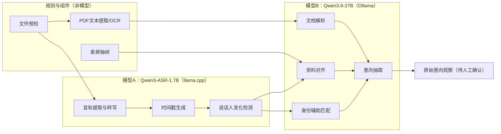

# 《意向宝》双模型 AI 实现开发文档

> 版本：V1.0（开发实施方案）
> 编制日期：2026-08-02
> 适用对象：技术实现者、验证评估者、产品整合者
> 目标：使用**两个本地 AI 模型**实现《05-意向宝智能体软件开发方案》首期 P0 中的全部 AI 处理功能

---

## 0. 结论摘要

意向宝首期 P0 的 AI 处理链路共 8 个阶段，本方案用两个本地模型覆盖其中 7 个需要模型能力的阶段，剩余 1 个阶段（文件预检）由规则代码完成：

| 模型 | 文件 | 大小 | 运行方式 | 负责阶段 |
| --- | --- | --- | --- | --- |
| 模型A：Qwen3-ASR-1.7B（Q8_0） | `Qwen3-ASR-1.7B.Q8_0.gguf` | 约 2.2GB | llama.cpp（qwen3-asr） | 音轨与转写、说话人分离 |
| 模型B：Qwen3.6-27B（Q4_K_M） | `Qwen3.6-27B-...-Q4_K_M.gguf` | 约 18GB | Ollama（本地） | 文档解析、画面与PDF解析（语义层）、资料对齐、身份辅助匹配、意向抽取 |
| 规则代码（非模型） | — | — | FastAPI 服务 | 文件预检 |

模型A 负责“听懂”：对录音／录屏音轨做转写，输出带时间戳的分段文本和说话人变化标记（Speaker A/B/C）。

模型B 负责“看懂并判断”：把转写稿、纪要、PDF 页面文本、录屏关键帧 OCR 文本整理成结构化证据，完成资料对齐、身份推荐和意向抽取，输出符合既有 `OllamaStructuredOutput` 契约的原始意向观察。

两个模型全部本地运行，天然满足“企业真实敏感数据只允许本地或企业内网处理”的数据约束。

---

## 1. 现有实现链路盘点（代码现状）

### 1.1 已实现的模型接入骨架

| 文件 | 内容 |
| --- | --- |
| `server/app/model_adapters.py` | `IntentModelAdapter` 抽象基类、`ModelContext` 输入结构、`MockIntentModelAdapter`、`OllamaIntentModelAdapter`、`get_model_adapter()` 工厂 |
| `server/app/model_settings.py` | `ModelSettingsStore` 运行时模型设置（provider/base_url/model_name/内存API Key），仅允许 `mock`、`ollama` 两种 provider，地址仅允许回环 |
| `server/app/schemas.py` | `OllamaIntentObservation`、`OllamaStructuredOutput`（作为 JSON Schema 下发给模型）、`OllamaAnalysisResult` |
| `server/app/services.py` | `run_analysis()` 同步编排：创建 `AnalysisRun` + 8 个 `ProcessingTask`，调用适配器，持久化观察 |
| `server/app/main.py` | `/api/model-settings`、`/api/model-settings/test`、`/api/meeting-packages/{id}/analyze` |

### 1.2 当前真实能力边界

- `OllamaIntentModelAdapter.analyze()` 已能调用本地 Ollama `/api/chat`，携带 JSON Schema（`format`）、`temperature=0`，输出经 `OllamaStructuredOutput` 严格校验。
- 可读取材料仅限 TXT、MD、SRT、VTT、DOCX 与资料包备注；录音、录屏、PDF 报“待专用解析”。
- 8 个任务阶段中只有“文件预检”和“意向抽取”真实执行；真实模型模式下其余阶段被标记为“不适用”，mock 模式全部规则化生成。
- 说话人、证据、观察的持久化模型（`SpeakerCluster`、`SpeakerSegment`、`EvidenceFragment`、`RawIntentObservation`）已齐备，但尚无真实转写、分离、对齐、身份推荐的数据来源。
- 证据校验要求 AI 输出的 `quote` 能在原材料中**逐字定位**（`_locate_exact_quote`），这是现有链路最重要的可信度门槛，双模型方案必须延续。

### 1.3 缺口清单

1. 无 ASR 适配器，无法处理录音／录屏音轨。
2. 无说话人分离真实实现（仅 mock 生成 Speaker 片段）。
3. 无 PDF 文本提取／OCR／录屏关键帧管线。
4. 无资料对齐（转写片段 ↔ PDF 页面／关键帧）。
5. 无身份辅助匹配（说话人 → 姓名／角色／职能推荐）。
6. 意向抽取输入缺少转写文本、说话人、页面文本等上下文。
7. `run_analysis` 为同步执行，60–90 分钟会议的处理必须改为后台阶段化执行。
8. 模型设置为单一 provider，需要扩展为“ASR 模型 + 意向 LLM”双配置。

---

## 2. 双模型总体架构

### 2.1 模型分工



### 2.2 阶段与模型映射

| 阶段（TASK_STAGES） | 实现方式 | 输出落库 |
| --- | --- | --- |
| 文件预检 | 规则代码（现有） | `MaterialFile.parse_status`、资料完整性 |
| 文档解析 | 组件提取文本 + 模型B结构化整理 | `PdfPageText`、`TranscriptSegment`（转写稿）、纪要结构化 |
| 音轨与转写 | 模型A | `TranscriptSegment`（start/end/text/confidence/language） |
| 说话人分离 | 模型A 说话人变化检测（Speaker A/B/C） | `SpeakerCluster` + `SpeakerSegment` |
| 画面与PDF解析 | 组件（文本提取／OCR／抽帧）+ 模型B语义摘要 | `PdfPageText`、`KeyFrame` |
| 资料对齐 | 模型B 语义匹配 | `AlignmentLink`（片段↔页面／关键帧，含置信度与理由） |
| 身份辅助匹配 | 模型B | `SpeakerCluster.recommended_*` |
| 意向抽取 | 模型B（沿用现有 JSON Schema 契约） | `RawIntentObservation`、`EvidenceFragment` |

### 2.3 运行顺序与资源策略

单 Worker、串行执行，两个模型**不同时驻留显存**：

1. 文件预检、文档解析、PDF／画面解析（组件为主，模型B轻量参与）。
2. 模型A 加载：转写＋说话人变化检测 → 落盘 `TranscriptSegment` / `SpeakerSegment` → 释放模型A（退出 llama.cpp 进程）。
3. 模型B 加载：身份辅助匹配 → 资料对齐 → 意向抽取 → 输出观察 → 释放模型B。
4. 人工确认阶段不占用模型资源。

> 资源基线：RTX 4060 Ti 16GB 显存、16GB 系统内存。模型A约2.2GB，可整卡放入；模型B文件18GB超过显存，采用“GPU 分层卸载＋CPU 兜底”策略，见 §8.3。两个模型串行运行可避免同时占满内存。

---

## 3. 模型服务部署

### 3.1 模型A：llama.cpp qwen3-asr

Qwen3-ASR 的 GGUF 由 llama.cpp 的 qwen3-asr 工具链支持，提供：

- 分段转写与时间戳（词级／片段级）；
- 说话人变化检测（输出 `Speaker A/B/C` 标记，等价于单场会议内的说话人分离）；
- 热词／上下文偏置（`hotwords`），用于技术词、产品平台名、缩写纠偏；
- 中英等语言识别。

推荐两种接入方式，二选一：

1. **命令行一次性处理**（实现最快）：

```text
llama-qwen3-asr-cli -m <Qwen3-ASR-1.7B.Q8_0.gguf> -f <audio.wav> ^
  --language zh --hotwords "Mini LED,AGLR,STW,圆偏光,三模"
```

2. **常驻服务**（推荐，便于长任务与重试）：使用带 ASR 支持的 llama.cpp server（OpenAI 兼容 `/v1/audio/transcriptions` 或等价接口），后端通过 `AsrAdapter` 调用。

> 具体参数名以实际安装的 llama.cpp 版本为准，接入前先跑通最小样本（1 分钟音频）再上长音频。

### 3.2 模型B：Ollama 导入 GGUF

在装有模型的机器上，把 18GB GGUF 注册为 Ollama 模型：

```text
Modelfile:
FROM D:\意向宝AI大赛\Qwen3.6-27B-Fable-Fus-711-UnHeretic-NM-DAU-NEO-MAX-NEO-Q4_K_M\Qwen3.6-27B-Fable-Fus-711-UnHeretic-NM-DAU-NEO-MAX-NEO-Q4_K_M.gguf

# 如需要可显式指定上下文、量化等参数：
PARAMETER temperature 0
PARAMETER num_ctx 16384
```

```text
ollama create qwen3.6-27b -f Modelfile
ollama list
```

模型B只作为本地 Ollama 服务被调用，沿用现有 `OllamaIntentModelAdapter` 的 HTTP 调用方式，不引入新依赖。

### 3.3 数据属性约束

| 数据属性 | 模型A（本地ASR） | 模型B（本地Ollama） | 规则组件 |
| --- | --- | --- | --- |
| 模拟数据 | 允许 | 允许 | 允许 |
| 授权脱敏数据 | 允许 | 允许 | 允许 |
| 企业真实敏感数据 | 允许（仅本地） | 允许（仅本地） | 允许 |

两个模型均为本地运行，符合方案要求；代码层面仍保留 `data_scope` 守卫：`mock` 适配器禁止处理非模拟数据，任何远程 provider 未获批准前不得启用。

---

## 4. 适配器与接口设计

沿用现有“Provider-Neutral Boundary”模式，新增两组适配器，前端与业务代码不感知供应商差异。

### 4.1 ASR 适配器

`server/app/audio_adapters.py`：

```python
@dataclass
class AsrSegment:
    start_ms: int
    end_ms: int
    text: str
    speaker_label: str | None      # "Speaker A" / None
    confidence: float
    language: str | None

@dataclass
class AsrResult:
    segments: list[AsrSegment]
    model_name: str
    prompt_version: str
    usage: dict | None

class AsrAdapter(ABC):
    name: str
    @abstractmethod
    def transcribe(
        self, audio_path: Path, *,
        language: str | None,
        hotwords: list[str],
    ) -> AsrResult: ...

def get_asr_adapter(provider: str, *, base_url: str, model_name: str) -> AsrAdapter: ...
```

实现类：`LlamaCppAsrAdapter`（调用 llama.cpp server 或 CLI 包装器）。

### 4.2 LLM 阶段适配器

把现有 `IntentModelAdapter` 扩展为按阶段提供方法，或拆分为多个小适配器（推荐拆分，便于独立评测与替换）：

```python
class LlmStageAdapter(ABC):
    name: str
    model_name: str

    @abstractmethod
    def parse_documents(self, context: StageContext) -> DocumentParseResult: ...

    @abstractmethod
    def recommend_identities(self, context: StageContext) -> IdentityRecommendationResult: ...

    @abstractmethod
    def align_materials(self, context: StageContext) -> AlignmentResult: ...

    @abstractmethod
    def extract_intents(self, context: StageContext) -> dict: ...   # 复用现有 analyze 契约
```

`StageContext` 是各阶段的统一输入：资料包信息、`data_scope`、材料摘要、主数据字典、历史正式状态（可选）。

实现类：`OllamaLlmStageAdapter`（复用 `OllamaIntentModelAdapter` 的 HTTP 客户端、超时、错误归一化逻辑）。

> 兼容性：保留 `get_model_adapter("mock"|"ollama")` 与 `run_mock_analysis()`，演示与回归测试不受影响。

---

## 5. 各阶段实现设计

### 5.1 文件预检（规则代码）

沿用现有 `_preflight_uploaded_file`、格式／大小／磁盘校验；新增：

- 音频时长探测（FFprobe），超过 120 分钟提示拆分；
- PDF 页数探测；
- 录屏关键帧数量预算（按时长估算）。

### 5.2 文档解析（模型B）

输入：人工纪要、转写稿（TXT/MD/SRT/VTT/DOCX）、文本型 PDF。

处理：

1. 组件提取：PDF 用 `pymupdf`/`pdfplumber` 提取每页文本 → `PdfPageText`；DOCX 用现有安全 ZIP 解析；SRT/VTT 解析为带时间戳的片段。
2. 模型B整理：把非结构化纪要／转写稿整理为 `{speaker_hint?, start_ms?, end_ms?, text}` 列表，供后续对齐与意向抽取使用。

输出契约（JSON Schema 摘要）：

```json
{
  "segments": [
    {
      "speaker_hint": "赵总",
      "start_ms": 120000,
      "end_ms": 142000,
      "text": "如果样机验证通过，可以把Mini LED放进明年高端5K路线图。",
      "confidence": 0.9
    }
  ]
}
```

### 5.3 音轨与转写（模型A）

输入：录音（MP3/WAV/M4A）或录屏提取的音轨（FFmpeg）。

处理：

1. FFmpeg 抽取音轨并转为 16kHz 单声道 WAV（与 ASR 输入要求一致）。
2. 构建热词表：当前客户名、参会人名、技术名、平台名、别名、资料包备注关键词。
3. 调用模型A转写，输出带时间戳的分段文本与说话人标记。
4. 落库 `TranscriptSegment`；生成 `MaterialFile.parse_status = "解析完成"`。

结果示例：

```json
{
  "segments": [
    {"start_ms": 120000, "end_ms": 142000, "text": "如果样机验证通过，可以把Mini LED放进明年高端5K路线图。", "speaker_label": "Speaker A", "confidence": 0.93, "language": "zh"}
  ]
}
```

### 5.4 说话人分离（模型A）

- 使用模型A的说话人变化检测生成 `Speaker A/B/C` 标签，按标签聚合为 `SpeakerCluster`，逐段写入 `SpeakerSegment`（现有表，含 `overlapping` 标记）。
- 重叠发言、低置信度片段显式标记不确定性，不静默合并。
- 人工校验台沿用现有“合并／拆分／批量修改”交互；人工修改结果保存到 `SpeakerIdentityMapping`，重跑模型不得覆盖（现有乐观锁已保证）。

> 说明：这是“单场会议内的说话人变化检测”，不是跨会议声纹库，符合方案 §7.1 边界。

### 5.5 画面与PDF解析（组件 + 模型B）

无视觉模型是本方案最重要的边界，策略如下：

| 材料 | 处理 |
| --- | --- |
| 文本型 PDF | `pymupdf` 直接提取文本，按页保存 `PdfPageText` |
| 扫描型 PDF | 轻量 OCR 组件（如 PaddleOCR / Tesseract）生成带页码文字块；OCR 组件不作为“第三个模型”，仅作可选增强；未安装时标记“待专用解析”并降级 |
| 录屏 MP4 | FFmpeg 按画面变化抽关键帧 → `KeyFrame`（时间、图片路径、哈希）；关键帧 OCR 文本由 OCR 组件或模型B视觉能力不可用时留空 |
| 关键帧语义摘要 | 模型B对页面文本／OCR 文本生成语义摘要与页面候选 |

关键帧数量受预算限制（默认按会议时长与页面变化密度估算上限），不整段逐帧提交模型。

### 5.6 资料对齐（模型B）

输入：转写片段（含说话人）、PDF 页面文本、关键帧 OCR 文本。

模型B按片段语义匹配零到多个页面／关键帧，输出：

```json
{
  "alignments": [
    {
      "segment_id": "seg-0007",
      "target_type": "pdf_page",
      "target_id": "page-12",
      "confidence": 0.86,
      "reason": "片段提到AGLR结构厚度，与第12页规格表一致"
    }
  ]
}
```

落库 `AlignmentLink`；低置信度匹配不作为唯一正式证据（现有 `_persist_model_observations` 的 quote 校验天然保证了这一点），人工可修正或取消。

### 5.7 身份辅助匹配（模型B）

输入：参会人名单（`MeetingAttendee`）、说话人片段、纪要称呼、发言语义。

模型B推荐：

```json
{
  "speakers": [
    {
      "speaker_label": "Speaker A",
      "display_name": "赵总",
      "role": "产品规划负责人",
      "organization": "产品规划部",
      "function_id": "function-product",
      "granularity": "完整",
      "confidence": 0.88,
      "reason": "开场自我介绍与纪要称呼一致，发言内容符合产品规划职责"
    }
  ]
}
```

写入 `SpeakerCluster.recommended_*`；只推荐不写正式，人工校验后才形成 `SpeakerIdentityMapping`。无法判断时保留“待确认”，不进入正式统计（现有规则已实现）。

### 5.8 意向抽取（模型B）

沿用现有 `OllamaStructuredOutput` JSON Schema 与校验逻辑，仅扩展输入：

- 转写片段（含说话人与时间戳）；
- 资料对齐结果（页面／关键帧证据）；
- 已确认说话人身份；
- 主数据字典（技术、平台、职能、别名）；
- 可选：该客户／技术的历史正式状态（供“态度变化”对比提示）。

维持三条铁律：

1. `temperature=0` + JSON Schema 强制结构化；
2. 每条观察必须含可逐字核对的 `quote`（`_locate_exact_quote` 校验）；
3. 证据不足时 `attitude_level=null` 并填 `uncertainty_reason`，不把“未知”误判为 1–5 档。

---

## 6. 数据模型扩展

### 6.1 新增表

```text
transcript_segments      # 模型A转写结果
  id, analysis_run_id, package_id, material_file_id,
  order_index, start_ms, end_ms, text, speaker_label,
  language, confidence, output_hash

pdf_page_texts           # 文档解析结果
  id, material_file_id, page_no, text, char_count,
  extracted_by, hash

key_frames               # 录屏关键帧
  id, material_file_id, time_ms, image_relative_path,
  image_sha256, ocr_text, page_candidates_json

alignment_links          # 资料对齐结果
  id, analysis_run_id, package_id, segment_id,
  target_type, target_id, confidence, reason,
  status, confirmed_by, confirmed_at
```

### 6.2 扩展现有表

| 表 | 扩展 |
| --- | --- |
| `ProcessingTask` | 新增 `result_json`（Text，可空）：保存阶段输出摘要，便于断点恢复与审计；沿用 `output_hash` 做幂等 |
| `AnalysisRun` | `result_summary` 增加各阶段模型名、耗时、输入输出统计 |
| `MaterialFile` | `parse_status` 增加“音轨已提取”“转写完成”“页面已解析”“待专用解析”等状态 |
| `EvidenceFragment` | `locator` 统一支持 `00:18:20–00:18:42`、`第12页`、`画面 00:42:16`；`start_ms/end_ms/page_no/frame_no` 字段已具备 |

### 6.3 派生文件目录

```text
server/data/projects/<project-id>/<package-id>/
  source/      # 原始上传
  derived/     # 音频WAV、转写JSON、PDF页面文本、关键帧
  evidence/    # 证据引用
```

派生文件由 `MaterialFile.relative_path` 体系外独立管理，与原始文件生命周期分离；删除原始文件时提示证据回放可能失效（现有规则）。

---

## 7. 任务编排与恢复

### 7.1 阶段执行器

将 `run_analysis` 改为“创建运行 → 后台串行执行各阶段”：

```text
POST /api/meeting-packages/{id}/analyze
  → 创建 AnalysisRun + 8 个 ProcessingTask（202 立即返回）
  → 后台 Worker 依次执行：
     预检 → 文档解析 → 音轨与转写 → 说话人分离
     → 画面与PDF解析 → 资料对齐 → 身份辅助匹配 → 意向抽取
  → 每阶段结束更新 progress/status/output_hash 并提交事务
```

执行器关键规则：

- 阶段幂等：同 `analysis_run_id + stage + output_hash` 不重复写入。
- 失败恢复：阶段失败记录 `error_message`，资料包进入“处理失败”；重试时从最近成功阶段继续，不重跑已成功阶段。
- 超时与取消：支持取消任务；模型调用超时沿用现有 300s 上限，长音频转写按音频分段执行。
- 并发：单 Worker 串行，禁止默认并行处理多场会议（方案 §14.2）。

### 7.2 与现有代码的衔接

- `run_mock_analysis()`、`_persist_mock_observations()` 保留给模拟演示与回归测试。
- `_persist_model_observations()` 的 quote 校验、主数据映射、五档校验逻辑复用，仅输入来源改为真实转写片段。
- `/api/model-settings/*` 扩展为双模型配置（见 §8.4）。

---

## 8. 模型设置与资源管理

### 8.1 设置存储扩展

`model-settings.json` 从单 provider 扩展为两槽位：

```json
{
  "intent": {
    "provider": "ollama",
    "base_url": "http://127.0.0.1:11434",
    "model_name": "qwen3.6-27b"
  },
  "asr": {
    "provider": "llamacpp",
    "base_url": "http://127.0.0.1:8081",
    "model_name": "Qwen3-ASR-1.7B.Q8_0.gguf"
  }
}
```

兼容策略：保留旧字段读取逻辑，`GET /api/model-settings` 返回两槽位 + `legacy` 摘要；API Key 仍只存进程内存，不回显。

### 8.2 设置页交互

- “ASR 模型”：provider（llamacpp）、服务地址、模型名、连接测试。
- “意向模型”：provider（ollama）、服务地址、模型名、可选 API Key、连接测试与模型列表（现有能力）。
- 启动分析时同时检查两个模型可用性，任一不可用则提示先配置。

### 8.3 显存／内存策略（RTX 4060 Ti 16GB + 16GB RAM）

1. 串行加载：先 ASR 后 LLM，进程级释放。
2. 模型B分层卸载：Ollama 配置 `num_gpu` 使模型权重＋KV Cache 尽量占满可用显存，剩余层跑 CPU；上下文控制在 8–16K，`num_batch` 调小，避免 OOM。
3. 长音频分段转写：ASR 逐段处理并即时落盘，避免单次占用过多内存。
4. 预留观测：记录每阶段峰值内存与耗时，写入 `AnalysisRun.result_summary`，作为调参与验收依据。

> 风险提示：18GB Q4_K_M 在 16GB 显存 + 16GB 内存下必然存在 CPU 卸载，端到端速度可能慢于会议原时长。该目标（§14.1）标记为“待实测”；演示优先用小上下文、短样本，不承诺实时完成。

### 8.4 启动检查

`启动意向宝.bat` 增加环境自检：ASR 服务端口、Ollama 服务与模型、FFmpeg、PDF 解析组件；缺项给出中文提示而不是静默失败。

---

## 9. 实现步骤与里程碑

| 里程碑 | 内容 | 退出条件 |
| --- | --- | --- |
| M1 模型A接入 | llama.cpp qwen3-asr 跑通；`AsrAdapter`；转写＋时间戳＋说话人标记落库 | 一段 10 分钟录音端到端生成 `TranscriptSegment` 与 `SpeakerSegment` |
| M2 模型B阶段化 | 文档解析、资料对齐、身份匹配、意向抽取四个 LLM 阶段接入并落库 | 文本材料包（含录音转写）全链路生成待确认观察 |
| M3 编排与恢复 | 后台 Worker、阶段幂等、失败重试、断点续跑 | 人为中断后重试能从最近成功阶段继续 |
| M4 评测调优 | 5–10 份授权脱敏会议材料 + ≥30 条金标准；指标统计与错例分析 | 结构化准确率与证据可追溯率可量化报告 |
| M5 演示交付 | 看板联动、双模型设置页、启动自检、模拟数据标识 | 双击启动即可演示完整链路 |

---

## 10. 验证与指标

### 10.1 测试层次

| 层次 | 重点 |
| --- | --- |
| 单元测试 | JSON Schema 校验、quote 定位、阶段幂等、状态机、主数据映射 |
| 组件测试 | ASR 输出解析、说话人聚合、PDF 文本提取、关键帧抽帧、对齐输出校验 |
| 集成测试 | 上传 → 分析 → 待确认观察全链路（真实双模型） |
| 交互测试 | 说话人校验台合并／拆分、意向确认、证据下钻 |
| 性能测试 | 60–90 分钟会议端到端耗时与峰值内存（待实测） |
| 安全测试 | data_scope 隔离、真实身份访问、路径保护、删除审计 |

### 10.2 指标口径

| 指标 | 目标 |
| --- | --- |
| ASR 字错率／词错率 | 逐段统计，热词表前后对比 |
| 说话人变化检测错误率 | 与人工标注片段对比 |
| 身份匹配准确率 | 推荐姓名／角色／职能与人工确认一致性 |
| 页面对齐准确率 | 高置信匹配正确率；低置信不作为正式证据 |
| 关键意向结构化准确率 | 目标 ≥85%（客户、技术、平台、职能、态度、证据全部正确） |
| 证据可追溯率 | 已确认结果 100% 可定位会议、日期与证据 |
| 未知保护 | 无证据不得判定 1–5 档 |

所有模型、提示词、规则版本随 `AnalysisRun` 记录，评测报告公开样本量、指标与错例，不把“模拟数据”写成真实成绩。

---

## 11. 风险与应对

| 风险 | 影响 | 应对 |
| --- | --- | --- |
| 18GB 模型在 16GB 显存＋16GB 内存下慢 | 长会议超时 | 串行加载、分层卸载、小上下文、分段处理；备选更小量化模型；指标标“待实测” |
| ASR 技术词／缩写误转 | 实体识别错误 | 主数据热词表、PDF 上下文、人工修正、错例迭代 |
| 说话人变化检测在插话／远场误判 | 分离错误 | 人工合并／拆分（现有校验台）、重叠标记、不确定性显式输出 |
| 无视觉模型 | 扫描 PDF、画面理解受限 | OCR 组件可选增强；无法解析时标记“待专用解析”，不伪造页面证据 |
| 对齐低置信 | 证据错配 | 只保留候选＋置信度＋理由，人工确认后才成为正式证据 |
| 模型覆盖人工结论 | 历史失真 | 分层存储与追加版本（现有），重跑不覆盖人工标注 |
| 双模型同时占用内存 | OOM | 进程级串行、阶段结束主动释放 |
| 模拟数据被当真实成绩 | 参赛材料失真 | 页面强制标识“模拟数据”，评测单列 |

---

## 12. 待办与技术验证清单

- [ ] llama.cpp qwen3-asr 在当前硬件上跑通 60–90 分钟音频，记录耗时与峰值内存；
- [ ] ASR 热词表对 Mini LED、AGLR、STW、圆偏光、三模等词条的纠偏效果；
- [ ] 说话人变化检测在插话、远场、多人场景的横向样本测试；
- [ ] 模型B 分层卸载参数（num_gpu / num_ctx / num_batch）实测；
- [ ] 文本型 PDF 提取与扫描型 PDF OCR 的分工与降级路径；
- [ ] 5–10 份授权脱敏会议材料与 ≥30 条人工金标准；
- [ ] 资料对齐低置信阈值与人工修正闭环；
- [ ] 双模型设置页、启动自检与演示脚本。

---

## 13. 结论

本方案以“专用识别模型（模型A）＋通用推理模型（模型B）”的分阶段架构覆盖意向宝首期全部 AI 功能：模型A负责听懂并分离说话人，模型B负责解析、对齐、匹配与意向抽取。该设计延续现有适配器、结构化契约、证据校验与人工确认体系，可替换、可评测、可追溯，且两个模型均为本地运行，满足数据安全边界。

