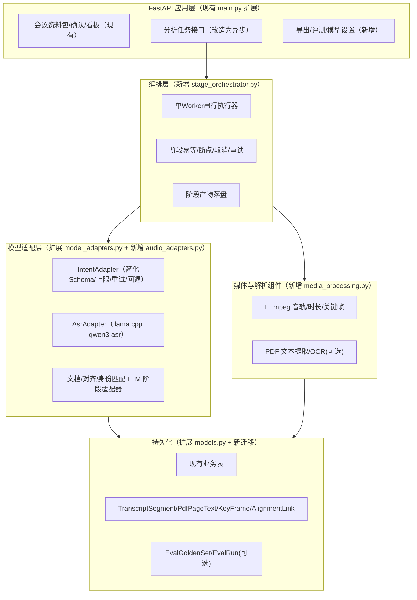

# 《意向宝》后端模型实现差距分析与完整功能开发文档

> **当前状态（2026-09 更新）**：本文列出的 8 阶段链路已在当前代码中
> 落地并通过真实素材验证；文本侧意向抽取模型当前为 Ollama
> `qwen3.5:9b`（旧文档中的 qwen3.6-27b 已弃用，不必再导入）。
> 新环境安装与运行请以根目录 `新电脑运行指南.md` / `README.md` 为准。

> 版本：V1.0（开发实施方案）
> 编制日期：2026-08-02
> 依据：《05-意向宝智能体软件开发方案》V1.0、《意向宝课题报告》V1.0、《P0_ACCEPTANCE.md》、《CODE_REVIEW_20260801.md》
> 目标：在现有后端代码基础上，补齐后端模型实现欠缺，实现项目规划要求的完整功能（P0 八阶段 AI 链路 + 文本主链路 MVP + 评测闭环）

---

## 0.5 实施状态（2026-08-02）

| 阶段 | 状态 | 说明 |
| --- | --- | --- |
| Phase 0 适配器加固 | ✅ 已完成 | 简化生成 Schema、num_predict、think:false、重试/回退、代码块剥离；qwen3.6-27b 实测跑通意向抽取 |
| Phase 1 文本主链路 | ✅ 已完成 | PDF 文本提取、SRT/VTT 解析、身份辅助匹配、资料对齐、意向输入扩展、结果导出（CSV/Excel/Markdown） |
| Phase 2 后台编排 | ✅ 已完成 | POST /analyze 202 立即返回 + 后台单 Worker 串行执行 + 失败兜底标记；前端已切换为任务轮询；阶段级落库（每阶段 commit）支撑断点排查 |
| Phase 3 ASR/说话人 | ✅ 已实测 | llama.cpp server + Qwen3-ASR-1.7B + mmproj 跑通转写；**FunASR（fsmn-vad + cam++ 声纹聚类，CPU 运行）已接入真实说话人分离**：VAD 切段 → 逐段声纹 → 层次聚类 → 逐段转写，产出带 speaker_label 的时间戳文本并自动建成 Speaker A/B/C 片段；身份校验台完成人工标注角色。说明：单人/无分离能力的素材自动回退整段转写 |
| Phase 4 评测体系 | ✅ 已完成 | 金标准对比、结构化准确率/未知误判/可追溯指标、错例导出（POST /api/eval/runs） |
| Phase 5 多模态与自检 | ✅ 已安装 | FFmpeg/FFprobe、Tesseract + chi_sim 中文包已装；关键帧抽帧 + OCR 已接入；环境自检接口与启动脚本提示可用 |

后端回归：145 passed；前端回归：35 passed。

ASR 实测结论（2026-08-02）：llama.cpp 官方 Windows 发布包不含 qwen3-asr 命令行工具，但 **llama-server + mmproj 即可支持 Qwen3-ASR**（`-m Qwen3-ASR-1.7B.Q8_0.gguf --mmproj mmproj-Qwen3-ASR-1.7B-Q8_0.gguf`，接口 `/v1/audio/transcriptions`）。工作区原来只缺 mmproj 文件，已补齐（339MB）。无需从源码编译。

## 0.6 三缺口补齐记录（2026-08-02）

### 异步编排切换

- `server/app/stage_orchestrator.py` 新增：后台单 Worker（线程）串行消费任务队列；`enqueue` 携带请求线程已解析的适配器，避免模型快照漂移；任务级失败兜底（适配器解析失败也标记运行与任务为处理失败）。
- `services.py` 拆分 `create_analysis_run`（请求线程内校验+落库，POST 返回 202）与 `execute_analysis_run`（Worker 执行）；`run_analysis` 保留为同步兼容入口。
- 无 force 时复用"已完成或运行中"的同条件运行，防止重复入队；前端 `waitForAnalysisCompletion` 轮询任务直到终态。
- 每完成一个阶段即 commit（阶段落盘），失败时已完成的阶段产物保留，可支撑断点排查。

### 前端配套入口

- 模型设置页新增 ASR（llama.cpp Qwen3-ASR）服务地址/模型名称配置与 `/api/env-check` 健康检测。
- 会议资料包详情新增 CSV/Excel/Markdown 导出按钮。
- 身份校验页新增说话人合并（勾选多个→合并到当前片段）与拆分（按转写片段移出）操作。
- 新增"模型评测"页：选择资料包、从 AI 草稿生成金标准模板、运行评测并展示结构化准确率/可追溯率/未知误判率与错例。

### 真实素材验证（发现并修复的真实问题）

1. **关键帧抽取 bug**：`select` 保留源帧 PTS 导致 `-frames:v` 与 image2 误计数，会写出大量重复帧；修复为 select 后 `setpts=N/(25*TB)` 规整时间戳（真实 60 秒录屏由 20 个重复帧修正为 5 个真实场景切点）。
2. **派生目录残留**：抽取前清理 `derived/frames/frame-*.jpg`，避免上一轮失败运行的旧帧污染本轮结果。
3. **产物接口跨运行累积**：页面/关键帧按"本次运行时间窗"过滤，force 重跑不再把历史运行产物混入当前产物。
4. **意向抽取契约过严**：本地 27B 模型在材料较多时输出 `technology_id:""` 空串或自创 JSON 结构；已把空 ID 归一化为 null（落库按"未解决"跳过，不伪造 1–5 档），并在回退提示词中给出完整 JSON 样例。
5. **失败回滚丢产物**：原实现只在运行结束统一 commit，失败时转写/页面/关键帧全部回滚；已改为阶段级 commit。

真实验证素材（保留在工作区根目录）：`test_audio_tangpoems.mp3`（LibriVox 唐诗朗诵）、`test_screen_recording.mp4`（由真实中文开发方案生成的演示录屏，含真实语音）、`test_real_chinese_doc.pdf`（真实中文方案文档）。实测：ASR 转写逐字准确；关键帧 5 个切点均不同；OCR（chi_sim）可读出演示级字号正文；PDF 6 页文本提取完整；意向抽取对无客户意向内容正确返回 0 条。

### 说话人分离引擎接入（2026-08-02 追加）

- 新增 `server/app/diarization.py`：`FunAsrDiarizer` = FunASR fsmn-vad（语音活动检测）→ cam++（说话人声纹）→ 余弦相似度层次聚类（阈值 0.45）→ `SpeakerTurn(start_ms, end_ms, speaker_label)`；模型走 ModelScope（`D:\意向宝AI大赛\tools\funasr-models`），CPU 推理，进程级单例懒加载，避免与 Ollama 抢 GPU。
- 音轨与转写阶段改造：先分离，再对每个说话人片段单独调用 Qwen3-ASR 转写，产出带说话人标签的时间戳文本；分离器不可用时自动回退整段转写（测试环境不受影响）。
- 实测（三个真实中文朗读者拼接的会议音频，63.6 秒）：VAD 分出 5 个语音段，聚类正确归为 3 个说话人，同一人被打断成多段也能正确归组；逐段转写内容与真实朗读者一一对应；`/api/speakers` 返回 Speaker A/B/C（状态"待确认"），身份校验台可人工标注角色。

---

## 0. 结论摘要

现有后端已完成「会议资料包 → 文件预检 → AI 草稿 → 人工确认 → 正式状态 → 看板 → 证据下钻与历史」的业务闭环，但在模型实现上只完成了 8 个阶段中的 2 个（文件预检、意向抽取），且意向抽取适配器存在真实模型鲁棒性缺口（已实测：完整 JSON Schema 会导致本地 27B 模型 grammar 解析失败；严格语法下模型可能无限生成）。其余 6 个模型阶段（文档解析、音轨与转写、说话人分离、画面与PDF解析、资料对齐、身份辅助匹配）均无真实实现。

本文档给出：

1. 规划回顾（开发方案 + 课题报告的模型目标与验收指标）；
2. 现有后端模型实现逐项盘点；
3. 差距分析（模型链路、适配器工程化、数据持久化、任务编排、部署运行五层）；
4. 在现有代码基础上的目标架构与分阶段实施路线；
5. 测试、评测与验收方案；
6. 风险与边界。

---

## 1. 规划回顾：项目需要什么

### 1.1 开发方案 P0 的 AI 处理链路（8 阶段）

```text
文件预检 → 文档解析 → 音轨与转写 → 说话人分离
→ 画面与PDF解析 → 资料对齐 → 身份辅助匹配 → 意向抽取
```

对应 P0 范围：

- 录音、录屏、转写稿、人工纪要、PDF、参会信息的资料包组织；
- 文件格式、大小、完整性、数据属性预检；
- 音轨提取、语音转写及时间戳；
- 多人会议说话人分离（Speaker A/B/C 片段）；
- 参会名单与发言内容驱动的身份推荐；
- PDF 解析、OCR、录屏关键帧提取及页面关联；
- 技术、客户、平台、客户项目、职能和别名匹配；
- 原始意向观察、五档态度、采用阶段、支持理由、阻力与卡点；
- 人工确认与受约束批量确认；
- 双视角看板、证据下钻和历史版本；
- 模拟数据标识、身份隔离、保存期限配置。

### 1.2 课题报告 MVP 定位

- 首期只跑文本主链路即可：已转写文本 → Qwen 模型抽取 → 结构化 JSON → 人工确认 → 结果导出／看板展示；
- 意向抽取候选：Qwen3.5-9B / Qwen3.6-27B；
- ASR 为 Could（候选 Qwen3-ASR-0.6B / 1.7B），不阻塞文本主链路验收；
- 必须保留：草稿与正式分层、未知不等于中立、AI 只建议、版本追加、模拟数据标识。

### 1.3 验收指标（后端模型必须支撑）

| 指标 | 目标 | 后端要求 |
| --- | --- | --- |
| 关键意向结构化准确率 | ≥85%（目标） | 可复现的评测流程、金标准隔离、版本记录 |
| 证据可追溯率 | 100% | 每条正式结论可定位会议、日期、角色、原文/时间戳/页码 |
| 未知误判率 | 0 | 无证据不得生成 1–5 档 |
| 人工确认覆盖率 | 100% | 未确认不进入正式看板 |
| 处理时效 | 60–90 分钟会议 ≤ 原时长（待实测） | 后台编排、阶段落盘、断点恢复 |

---

## 2. 现有后端模型实现盘点

### 2.1 已实现的模型相关能力

| 文件 | 已实现内容 |
| --- | --- |
| server/app/model_adapters.py | IntentModelAdapter 抽象、ModelContext 输入结构、MockIntentModelAdapter、OllamaIntentModelAdapter（Ollama /api/chat + JSON Schema + temperature=0 + Pydantic 校验）、get_model_adapter 工厂；OpenAICompatibleModelAdapter 预留未启用 |
| server/app/model_settings.py | ModelSettingsStore：provider/base_url/model_name 持久化（非敏感字段）、API Key 仅内存、回环地址校验、连接测试与模型列表 |
| server/app/schemas.py | OllamaIntentObservation、OllamaStructuredOutput（输出契约 + 校验）、ModelSettingsUpdateRequest 等 |
| server/app/services.py | run_analysis 同步编排：创建 AnalysisRun + 8 个 ProcessingTask，文本材料读取（TXT/MD/SRT/VTT/DOCX + 备注，80K 字符上限）、主数据装配、_persist_model_observations 落库（quote 逐字校验、主数据 ID 映射、五档越界校验、AI 快照） |
| server/app/main.py | /api/model-settings（GET/PUT/test/models）、/api/meeting-packages/{id}/analyze（同步执行）、任务/说话人/观察/确认/看板/历史/证据 API |
| 数据表 | AnalysisRun、ProcessingTask、SpeakerCluster、SpeakerSegment、SpeakerIdentityMapping、EvidenceFragment、RawIntentObservation、FormalIntentStatus、AdoptionStageState、IdentityVault 等 |

### 2.2 已实现的业务规则

- 五档态度 + 未知保护（无证据不得判 1–5 档）；
- 双层意向模型（原始观察 → 正式职能状态）；
- 采用阶段与态度分离、状态键去重；
- 证据逐字定位校验（_locate_exact_quote）；
- 乐观锁版本、追加式历史、旧会议补录；
- 数据属性守卫（mock 禁止处理非模拟数据）；
- 身份校验台（推荐 → 人工确认 → 映射），职能未确认禁止进入正式统计；
- 管理员 Excel 平台菜单预检／发布。

---

## 3. 差距分析

### 3.1 模型链路差距（8 阶段 vs 现状）

| 阶段 | 现状 | 差距 | 目标实现 |
| --- | --- | --- | --- |
| 1 文件预检 | 已有格式、大小、磁盘、DOCX 安全、PDF 配套检查 | 缺音视频时长探测、PDF 页数探测、扫描件判定 | FFprobe 时长/流探测；PDF 页数；扫描件标记 |
| 2 文档解析 | 已有 TXT/MD/SRT/VTT/DOCX 文本提取 | 缺 PDF 文本提取、SRT/VTT 结构化片段、纪要结构化整理 | PdfPageText 落库；SRT/VTT 转时间戳片段；LLM 结构化整理（可选） |
| 3 音轨与转写 | 无 | 无 ASR 适配器、无 FFmpeg 音轨提取、无转写落库 | AsrAdapter；FFmpeg 抽取音轨；Qwen3-ASR 分段转写 + 时间戳 → TranscriptSegment |
| 4 说话人分离 | mock 生成 Speaker 片段 | 无真实说话人变化检测；无合并/拆分后端接口 | ASR 说话人变化检测 → SpeakerCluster/SpeakerSegment；合并/拆分/批量修改 API |
| 5 画面与PDF解析 | 无 | 无 PDF 文本/OCR、无录屏抽帧 | pymupdf 文本提取；OCR 组件（可选增强）；FFmpeg 关键帧 → KeyFrame |
| 6 资料对齐 | 无 | 无片段↔页面/关键帧匹配 | AlignmentLink 表；LLM 语义匹配 + 置信度/理由 + 人工修正 |
| 7 身份辅助匹配 | 无（mock 固定推荐） | 无 LLM 推荐 | 结合参会名单、称呼、发言语义 → SpeakerCluster.recommended_* |
| 8 意向抽取 | 已有 Ollama 文本链路 | 真实模型鲁棒性不足；输入缺少转写/页面/说话人上下文；无历史状态对比 | 见 3.2；输入扩展；历史状态提示 |

### 3.2 模型适配器工程化差距（含已实测问题）

以下问题为接入本地 Qwen3.6-27B 时实际复现，是当前最大的“能跑通演示”障碍：

| 问题 | 实测现象 | 根因 | 需要实现 |
| --- | --- | --- | --- |
| 完整 JSON Schema 无法作为 grammar | Ollama 返回 HTTP 400，日志 failed to parse grammar | 完整 Schema 含大量 $defs/maxLength 约束，转换出的 GBNF 规则过大 | 模型请求使用简化生成 Schema（保留字段名与必填项，去掉长度约束），响应仍用 OllamaStructuredOutput 严格校验 |
| 严格 grammar 下模型无限生成 | 无上限时 5 分钟生成 2698 token 不停；内容为空 | 模型在 grammar 约束下循环输出空白 | num_predict 上限（如 2048）+ done_reason=length 检测与重试 |
| format json 输出被代码块包裹 | 模型返回 Markdown 代码块包裹的 JSON | 宽松 grammar 下模型套用代码块 | 后处理剥离代码块（或统一走简化 Schema） |
| 无重试与回退 | 失败即整个任务失败 | 适配器单次调用 | 可配置重试（2–3 次）、失败分类（语法/超时/截断）、日志留痕 |
| 超时固定 300s | 大模型首次加载 + 长输出可能超时 | timeout_seconds=300 硬编码 | 超时按模型/任务可配；加载预热策略 |
| 输出长度无约束 | 观察数最多 100 条，无 token 预算 | 无 num_predict | 按输入规模动态计算预算 |

### 3.3 任务编排差距

| 差距 | 现状 | 需要实现 |
| --- | --- | --- |
| 后台执行 | POST /analyze 返回 202 但同步阻塞到完成，长任务会占满请求线程 | 202 立即返回 + 后台单 Worker 串行执行 + 前端轮询 |
| 断点续跑 | 失败后整包进入处理失败，重试全量重跑 | 阶段级持久化，重试从最近成功阶段继续 |
| 取消/重试接口 | 无 | POST /api/analysis-runs/{id}/cancel、POST /api/analysis-runs/{id}/retry |
| 阶段产物 | ProcessingTask 只有 output_hash | 增加 result_json（阶段输出摘要）+ 派生文件目录 |
| 幂等 | 相同适配器+模型已完成运行直接复用 | 阶段级幂等键（run+stage+hash），重复执行不重复写 |

### 3.4 数据持久化差距

需要新增的表（尚无迁移）：

```text
transcript_segments      # ASR 转写片段（start_ms/end_ms/text/speaker_label/confidence/language）
pdf_page_texts           # PDF 页面文本（page_no/text/extracted_by/hash）
key_frames               # 录屏关键帧（time_ms/image_path/image_sha256/ocr_text/page_candidates）
alignment_links          # 资料对齐（segment ↔ page/keyframe，confidence/reason/status/confirmed_by）
```

可选扩展：

```text
eval_golden_sets          # 金标准数据集（材料、标注、字段级答案）
eval_runs                 # 评测运行（模型/提示词版本、指标、错例 JSON）
```

派生文件目录尚未落盘规范：

```text
server/data/projects/<project-id>/<package-id>/
  source/      # 原始上传（现有）
  derived/     # 新增：音频WAV、转写JSON、PDF页面文本、关键帧
  evidence/    # 证据引用（现有）
```

### 3.5 API / 部署运行差距

- 缺导出接口（课题报告 MVP 主链路要求结果导出）：正式状态/观察/证据的受控导出（CSV/Excel/Markdown）；
- 缺说话人合并/拆分与批量修改后端接口（校验台需求）；
- 缺模型服务自检：启动脚本不检查 Ollama/llama.cpp/FFmpeg；
- 缺显存/内存观测：AnalysisRun.result_summary 应记录每阶段耗时与峰值内存；
- 缺评测入口：无金标准导入、指标计算、错例导出的后端能力；
- 模型设置仅单 provider 槽位，无法同时配置 ASR 模型与意向 LLM；
- OpenAICompatibleModelAdapter 未启用，企业内部模型服务接入路径缺失；
- 数据属性与 provider 白名单未绑定：应允许按 data_scope 配置本地/内网/禁用远程策略；
- 保存期限 retention_days 已建模，但无自动清理任务与删除影响提示流程。

---

## 4. 目标架构（在现有代码上扩展）

### 4.1 总体分层



### 4.2 双模型分工（延续《AI双模型实现开发文档》）

| 模型 | 运行方式 | 负责阶段 |
| --- | --- | --- |
| 模型A：Qwen3-ASR-1.7B（Q8_0） | llama.cpp qwen3-asr | 音轨与转写、说话人分离 |
| 模型B：Qwen3.6-27B（Q4_K_M） | Ollama | 文档解析、资料对齐、身份辅助匹配、意向抽取 |

> 文本主链路（MVP 优先）只依赖模型B，可先于 ASR 完成业务闭环。

### 4.3 模块与文件改动清单

| 文件 | 动作 | 内容 |
| --- | --- | --- |
| server/app/model_adapters.py | 改造 | 简化生成 Schema、num_predict、超时可配、重试、回退、代码块剥离、调用统计 |
| server/app/model_settings.py | 扩展 | 双槽位（asr/intent）配置；provider 白名单按 data_scope |
| server/app/audio_adapters.py | 新增 | AsrAdapter 抽象 + LlamaCppAsrAdapter |
| server/app/media_processing.py | 新增 | FFmpeg 封装（音轨/时长/关键帧）、PDF 文本提取、OCR 可选 |
| server/app/stage_orchestrator.py | 新增 | 后台单 Worker 执行器、阶段幂等、断点、取消、重试 |
| server/app/alignment.py | 新增 | AlignmentLink 模型方法 + LLM 对齐调用 |
| server/app/identity_matcher.py | 新增 | 说话人身份 LLM 推荐 |
| server/app/evaluation.py | 新增 | 金标准导入、指标计算、错例导出 |
| server/app/models.py | 扩展 | 新表 + ProcessingTask.result_json |
| server/migrations/versions/0004_media_pipeline.py | 新增 | 新表迁移 |
| server/app/main.py | 扩展 | 任务取消/重试、说话人合并拆分、导出、评测、双模型设置 API |
| server/app/services.py | 改造 | run_analysis 拆分为阶段函数，供编排器调用 |
| scripts/start-local.ps1 | 扩展 | 环境自检（FFmpeg、Ollama、ASR 服务、模型文件） |

---

## 5. 关键设计细节

### 5.1 意向抽取适配器加固（最高优先级）

针对已实测问题，OllamaIntentModelAdapter 改造为：

```text
1. 生成用简化 Schema（保留字段名/类型/必填，去掉 $defs 与长度约束）；
2. 请求 options: { temperature: 0, num_predict: 按输入规模计算 };
3. 校验 done_reason：length 且 JSON 不完整 → 重试（最多2次）或失败分类“输出截断”；
4. 对返回内容先剥离 ```json 代码块再做 model_validate_json；
5. 全部失败回退策略：重试一次“无 format + 提示词强约束”路径；
6. 记录 usage（token/耗时）与错误类别到 AnalysisRun。
```

简化生成 Schema 示例：

```json
{
  "type": "object",
  "properties": {
    "observations": {
      "type": "array",
      "items": {
        "type": "object",
        "properties": {
          "technology_id": {"type": "string"},
          "generic_platform_id": {"type": ["string", "null"]},
          "function_id": {"type": ["string", "null"]},
          "speaker_name": {"type": ["string", "null"]},
          "speaker_role": {"type": ["string", "null"]},
          "speaker_organization": {"type": ["string", "null"]},
          "quote": {"type": "string"},
          "attitude_level": {"type": ["integer", "null"]},
          "adoption_stage": {"type": ["string", "null"]},
          "support_reason": {"type": ["string", "null"]},
          "resistance_reason": {"type": ["string", "null"]},
          "bottlenecks": {"type": "array", "items": {"type": "string"}},
          "decision_influence": {"type": ["string", "null"]},
          "confidence": {"type": "number"},
          "uncertainty_reason": {"type": ["string", "null"]}
        },
        "required": ["technology_id", "quote", "confidence"],
        "additionalProperties": false
      }
    }
  },
  "required": ["observations"]
}
```

### 5.2 ASR 适配器契约

```python
@dataclass
class AsrSegment:
    start_ms: int
    end_ms: int
    text: str
    speaker_label: str | None
    confidence: float
    language: str | None

@dataclass
class AsrResult:
    segments: list[AsrSegment]
    model_name: str
    prompt_version: str
    usage: dict | None

class AsrAdapter(ABC):
    name: str
    @abstractmethod
    def transcribe(
        self, audio_path: Path, *,
        language: str | None,
        hotwords: list[str],
    ) -> AsrResult: ...
```

热词来源：当前客户名、参会人名、技术名、平台名、别名、资料包备注关键词。

### 5.3 新增数据表（迁移 0004）

```text
transcript_segments
  id, analysis_run_id, package_id, material_file_id,
  order_index, start_ms, end_ms, text, speaker_label,
  language, confidence, output_hash

pdf_page_texts
  id, material_file_id, page_no, text, char_count,
  extracted_by, hash

key_frames
  id, material_file_id, time_ms, image_relative_path,
  image_sha256, ocr_text, page_candidates_json

alignment_links
  id, analysis_run_id, package_id, segment_id,
  target_type, target_id, confidence, reason,
  status, confirmed_by, confirmed_at

processing_tasks.result_json   # 现有表新增列
```

### 5.4 新增 API

| 方法 | 路径 | 用途 |
| --- | --- | --- |
| POST | /api/analysis-runs/{id}/cancel | 取消进行中的任务 |
| POST | /api/analysis-runs/{id}/retry | 从失败阶段重试 |
| PATCH | /api/speakers/merge | 合并误拆说话人 |
| POST | /api/speakers/{id}/split | 拆分误合并片段 |
| GET | /api/packages/{id}/export | 导出正式状态/观察/证据（CSV/Excel/Markdown） |
| GET | /api/analysis-runs/{id}/artifacts | 阶段产物（转写/页面/关键帧/对齐）查询 |
| PUT | /api/model-settings/asr | ASR 模型配置（provider/地址/模型名/连接测试） |
| POST | /api/eval/golden-sets | 导入金标准 |
| POST | /api/eval/runs | 执行评测并输出指标 |
| GET | /api/env-check | 运行环境自检（FFmpeg/Ollama/ASR/磁盘） |

---

## 6. 分阶段实施路线

### Phase 0：模型适配器加固（0.5–1 周）

改动：model_adapters.py、model_settings.py、schemas.py

- 简化生成 Schema + num_predict + 重试/回退 + 代码块剥离；
- 超时与输出预算可配置；
- 用现有 qwen3.6-27b 模型跑通 package-a-new 真实分析。

验收：Ollama 模型对演示资料包输出通过 OllamaStructuredOutput 校验的观察；失败有明确错误分类。

### Phase 1：文本主链路完整化（1–2 周，对应课题报告 MVP）

改动：media_processing.py（PDF 文本提取）、identity_matcher.py、alignment.py（文本版）、main.py（导出）

- PDF 文本型页面提取 → PdfPageText；
- SRT/VTT 结构化片段；
- LLM 身份推荐（参会人 + 转写文本）；
- LLM 文本版资料对齐（片段 ↔ PDF 页面）；
- 意向抽取输入扩展（转写片段、页面文本、身份）；
- 结果导出接口。

验收：文本材料包全链路生成待确认观察，证据可定位到页面/时间戳；演示脚本可通过。

### Phase 2：后台编排与恢复（1 周）

改动：stage_orchestrator.py、services.py、main.py

- 202 立即返回 + 后台单 Worker 串行执行；
- 阶段幂等、断点续跑、取消、重试；
- ProcessingTask.result_json + 派生文件目录。

验收：人为中断后重试能从最近成功阶段继续；取消不再产生残留模型调用。

### Phase 3：ASR 与说话人接入（1–2 周，对应完整 P0）

改动：audio_adapters.py、media_processing.py、models.py 迁移

- FFmpeg 音轨提取与时长探测；
- Qwen3-ASR-1.7B 分段转写 + 时间戳 + 说话人变化检测；
- TranscriptSegment / SpeakerCluster / SpeakerSegment 真实落库；
- 说话人合并/拆分 API。

验收：一段 10 分钟录音端到端生成转写与 Speaker 片段；热词对技术词纠偏有效。

### Phase 4：评测体系（1 周）

改动：evaluation.py、main.py

- 金标准导入（5–10 份授权脱敏材料、≥30 条意向单元）；
- 指标：结构化准确率、字段级准确率、未知误判率、证据定位率、处理耗时与资源占用；
- 错例导出与提示词版本对比。

验收：可复现输出准确率报告；85% 如实标注为目标/实测而非成绩。

### Phase 5：多模态完善与演示（1 周）

改动：media_processing.py（关键帧/OCR）、alignment.py（画面版）

- 录屏关键帧抽帧 + OCR（可选组件）；
- 画面版资料对齐；
- 启动脚本环境自检；
- 模拟数据标识与演示脚本回归。

---

## 7. 测试与评测方案

### 7.1 测试层次

| 层次 | 重点 |
| --- | --- |
| 单元测试 | 简化 Schema 生成、JSON 剥离、num_predict 计算、quote 定位、阶段幂等、状态机 |
| 组件测试 | ASR 输出解析、说话人聚合、PDF 提取、关键帧抽帧、对齐输出校验 |
| 集成测试 | 上传 → 分析 → 待确认观察全链路（真实模型） |
| 交互测试 | 说话人合并/拆分、意向确认、证据下钻、导出 |
| 安全测试 | data_scope 白名单、真实身份访问、路径保护、删除审计 |
| 性能测试 | 60–90 分钟会议耗时与峰值内存（待实测） |

### 7.2 指标口径

- 关键意向结构化准确率：客户、技术、平台范围、职能、态度、证据全部正确计为正确；≥85% 为目标；
- 证据可追溯率：已确认结果 100%；
- 未知误判率：金标准未知字段被判 1–5 档的数量/总数，目标 0；
- ASR 字错率、说话人分离错误率、身份匹配准确率、页面对齐准确率单独记录；
- 人工修改结果不计入模型原始准确率。

---

## 8. 风险与边界

| 风险 | 应对 |
| --- | --- |
| 本地 27B 模型 grammar 不兼容（已实测） | 简化 Schema + num_predict + 回退；Phase 0 优先解决 |
| 严格 grammar 下模型循环生成 | 输出预算 + done_reason 检测 + 重试 |
| 16GB 显存 + 32GB 内存下 18GB 模型推理慢 | 串行加载、分层卸载、小上下文、长任务后台化；时效标“待实测” |
| 无视觉模型 | OCR 组件可选增强；无法解析时标记“待专用解析”，不伪造页面证据 |
| 技术词转写错误 | 主数据热词表、PDF 上下文、人工修正、错例迭代 |
| 真实样本/金标准不到位 | 先模拟数据跑通，85% 保持“目标”标识，不虚报成绩 |
| 双模型同时占用内存 | 进程级串行、阶段结束主动释放 |
| 企业真实敏感数据外流 | 仅本地模型；provider 白名单按 data_scope 绑定 |

---

## 9. 与已有文档的衔接

- 《AI双模型实现开发文档》：本文档的模型分工、接口设计与其一致，本文档补充后端差距与实施优先级；
- 《P0_ACCEPTANCE.md》：Phase 0–2 完成即可覆盖 P0a 验收的“模拟数据 + Ollama 文本链路”部分；
- 《课题报告》：Phase 1 的文本主链路对应报告“首期只跑文本主链路”的 PoC 要求；
- 现有 run_mock_analysis 与 mock 适配器保留，作为演示与回归基线。

---

## 10. 结论

现有后端已经具备完整的业务底座与单点意向抽取能力；补齐模型实现的关键顺序是：先加固意向抽取适配器（Phase 0）→ 跑通文本主链路（Phase 1）→ 后台编排（Phase 2）→ ASR/说话人（Phase 3）→ 评测（Phase 4）→ 多模态完善（Phase 5）。该路线不推翻现有代码，全部为增量扩展，且每个阶段都有可演示、可验收的退出条件。
